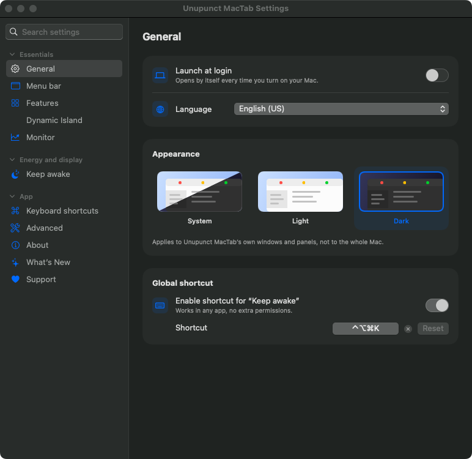
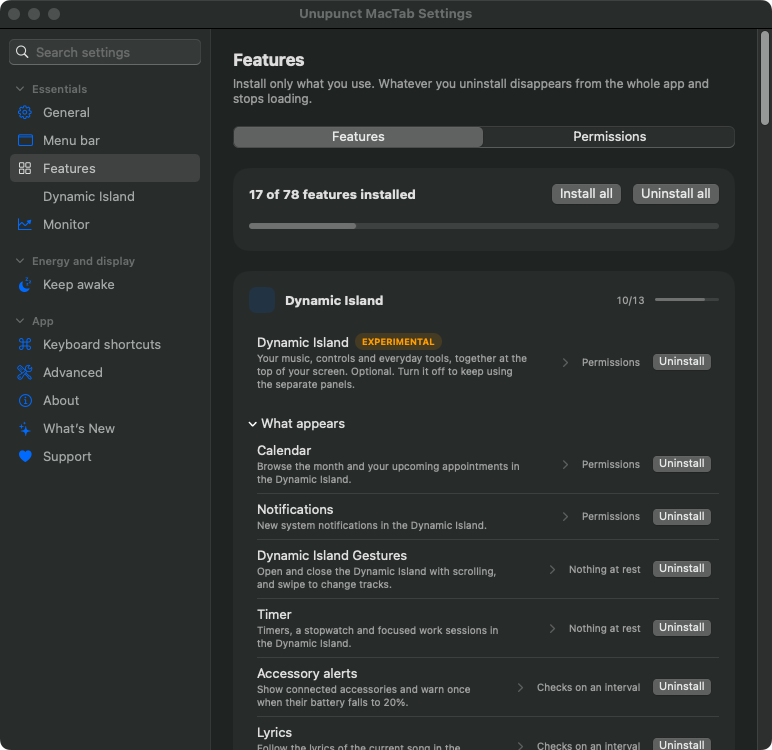
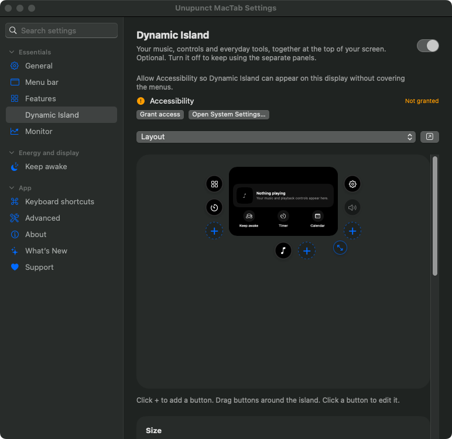
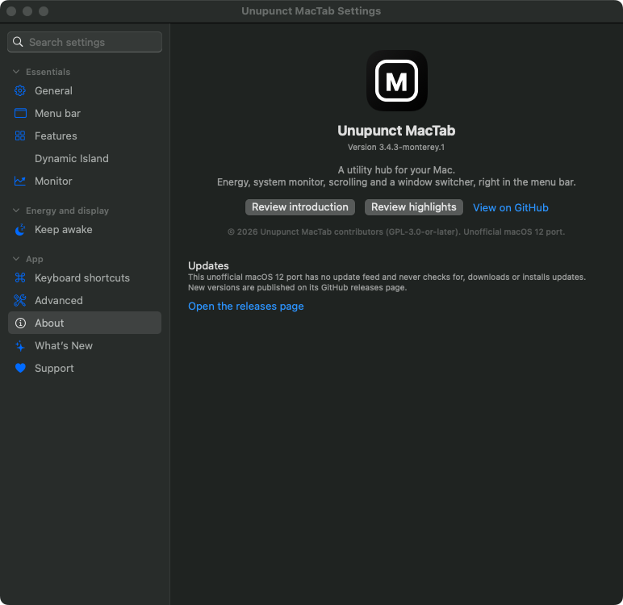
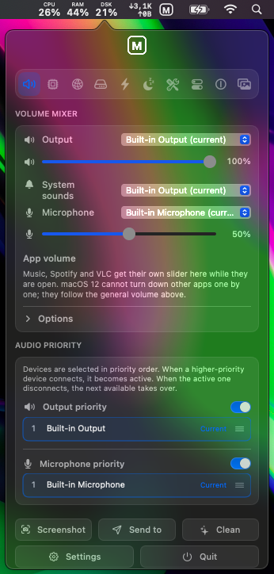

# Unupunct MacTab

**An unofficial port of [Vorssaint Utils](https://github.com/vorssaint/vorssaint-utils) to macOS 12 Monterey (Intel).**
A menu-bar hub of small Mac utilities: Keep Awake, a Dynamic-Island-style notch panel, window and Dock tools,
clipboard history, a system monitor, mouse and scroll tweaks and more. Install only the parts you use.

> **Read this first.** This is a community port, not the upstream project, and it is not endorsed by it.
> It was built and run on **one** Mac (MacBook Air, macOS 12.7.6, Intel x86_64). It starts, draws its windows
> and passes its built-in self-test there, but **most features have not been tested by hand**, the upstream unit
> tests have not been run, and Apple Silicon and other macOS versions are untested.
> The details, including exactly which features are switched off, are in
> [MONTEREY-COMPATIBILITY.md](MONTEREY-COMPATIBILITY.md).

<p align="center">
  
  
</p>
<p align="center">
  
  
</p>
<p align="center"><sub>Screenshots of the running app's Settings window, captured on macOS 12.7.6. They show default settings only.</sub></p>

## What this port adds

- **A panel built around the things you reach for most.** Click the menu bar icon for output and microphone volume sliders, then System, Network, Disk and Power, with **Screenshot**, **Send to** and **Clean** buttons underneath. The CPU, RAM, disk and network readings sit on the left of the icon.
- **Clean.** Opens a window with the app's junk cleaner, its app uninstaller and a new **Large files** finder. Everything is reviewed first and goes to the Trash.
- **Send to.** Copies chosen files to a folder, drive or mounted network location, or opens them in an app. You edit the list of destinations.
- **App volume** for Music, Spotify and VLC (macOS 12 cannot control other apps one by one).
- **Intel temperature sensors**, with LAN traffic shown where a Mac has no GPU sensor.
- A first-run setup that offers every tool this Mac can run.

<p align="center">
  
</p>
<p align="center"><sub>The panel as it looks now, captured on macOS 12.7.6. The CPU, RAM and disk readings are in the menu bar above it.</sub></p>

All of this was written for this port and has only been looked at on one Mac. See the limits below.

## Download and install

1. Get **`UnupunctMacTab-…-x86_64-macOS12.dmg`** from the [Releases](https://github.com/unupunct/Unupunct-s-MacTab/releases) page.
   (A SHA-256 checksum is listed in the release notes.)
2. Open the DMG and drag **Unupunct MacTab** onto **Applications**.
3. The app is **ad-hoc signed and not notarized**, so macOS blocks the first launch. Right-click the app,
   choose **Open**, then confirm. (Apple does not offer a one-click trust for unnotarized apps; do this only if
   you are comfortable with the source and the build described below.)
4. Grant the permissions each feature asks for (Accessibility, and others on demand).

Requirements: **macOS 12.3 or later, Intel (x86_64)**. It is not a universal binary.

## What works and what does not

Verified on macOS 12.7.6: it launches and keeps running, the Settings window and its pages render, the self-test
(`UnupunctMacTab --selftest`) reports OK.

Switched off on Monterey because the system lacks what they need (they are hidden or disabled, not faked):
fan control, the per-app volume mixer, the Dynamic Island's audio-driven bars, recording the Mac's own sound in
screen recordings. Launch-at-login uses a per-user LaunchAgent. The port has no update feed: it never checks for,
downloads or installs updates, and it does not send feedback or temporary share links to the upstream project's
servers. Layouts that depend on newer SwiftUI (grids, `ViewThatFits`, form styles) are approximated and can look
different from upstream.

Everything else is **unverified**. See the table in [MONTEREY-COMPATIBILITY.md](MONTEREY-COMPATIBILITY.md).

## Build from source

On a Mac with the Command Line Tools (Xcode is not needed):

```sh
git clone https://github.com/unupunct/Unupunct-s-MacTab.git
cd Unupunct-s-MacTab
./build-monterey.sh        # about 15 minutes; writes build/Unupunct MacTab.app, a .zip and a .dmg
```

The script checks the OS, compiler, SDK and architecture first, and fails loudly instead of claiming success.
Upstream's own `build.sh` and `Package.swift` are unchanged and build the macOS 14+ upstream app, not this port.

## Credits, licence and trademarks

- Based on **Vorssaint Utils** by the Vorssaint contributors (upstream release 3.4.3). The original README is kept
  as [README-UPSTREAM.md](README-UPSTREAM.md); its feature list describes the upstream macOS 14+ app.
- Licensed under **GPL-3.0-or-later**, like the original: see [LICENSE](LICENSE). Source for every release is this
  repository.
- Following upstream's [TRADEMARKS.md](TRADEMARKS.md), this port uses its own name, icon, bundle identifier
  (`local.unupunct.mactab`) and signing (ad-hoc), and does not use upstream's update feed, feedback or share servers,
  donation links or support channels. (One read-only exception: the optional AI-agent usage feature downloads a
  public price list, `agent-prices.json`, from upstream's GitHub repository.) For upstream, go to <https://github.com/vorssaint/vorssaint-utils>.
- Problems with this port belong in this repository's [Issues](https://github.com/unupunct/Unupunct-s-MacTab/issues),
  not with the upstream maintainer.
